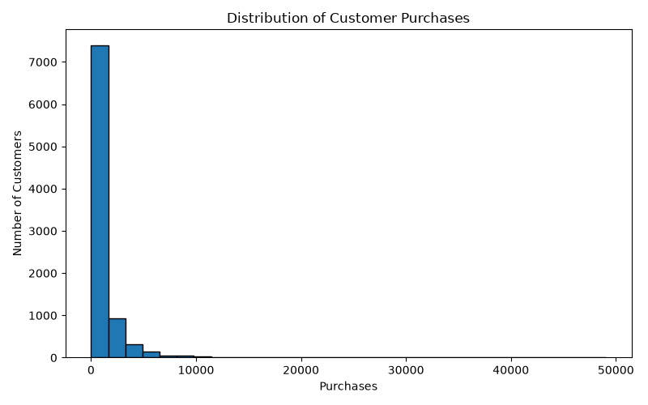
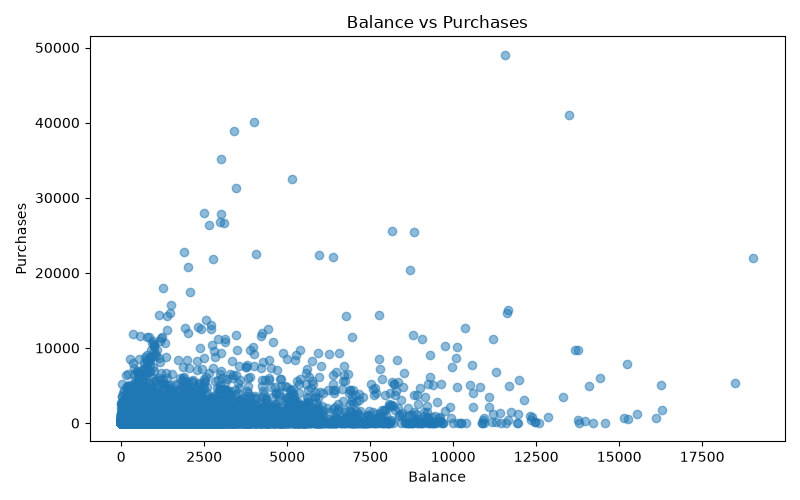
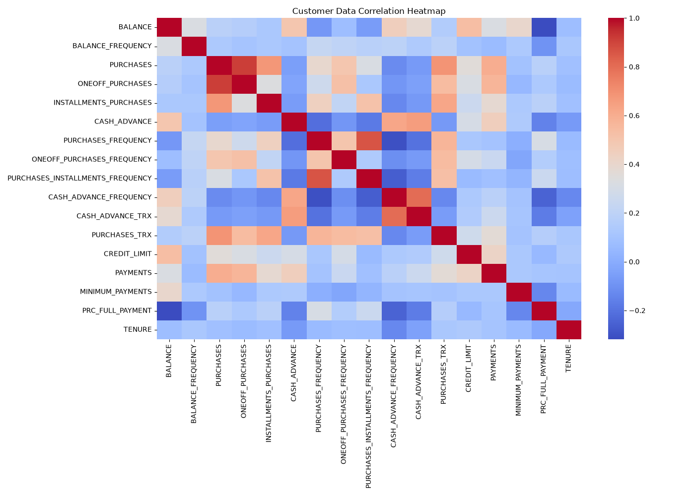
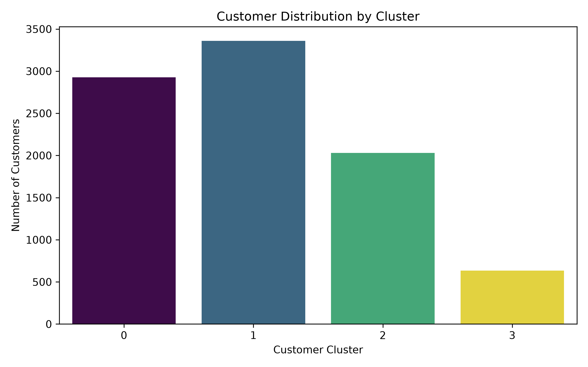

# Marketing Department Project

## 📌 Overview

This project focuses on analyzing marketing data to derive insights that can enhance marketing strategies and decision-making processes.

## 📂 Project Structure

          Data-Driven-Marketing-Department-Project/

│
├── Market_Department_Png/
│
├── Marketing Department Project Png/
│ ├── Customer_segmentation.py
│ ├── Cluster_distribution.py
│ ├── Business_Recommendations.md
│ ├── Customer_Segments.csv
│ ├── heatmap.png
│ ├── scatter.png
│ ├── balance_vs_purchases.png
│ └── customer_cluster_distribution.png
│
├── Marketing_data.csv
├── Marketing_data_Cleaned.csv
├── Market_Department_Project.ipynb
└── README.md

## 📊 Dataset

The dataset, `Marketing_data.csv`, includes information pertinent to marketing campaigns, such as:

- **Customer ID**: Unique identifier for each customer.
- **Age**: Age of the customer.
- **Gender**: Gender of the customer.
- **Income**: Annual income of the customer.
- **Spending Score**: Score assigned based on customer spending behavior.
- **Purchase History**: Record of past purchases made by the customer.
- **Campaign Response**: Customer's response to previous marketing campaigns.

## Installation & Setup

Follow these steps to run the project locally.

### 1. Clone the Repository

```bash
git clone YOUR_GITHUB_REPOSITORY_URL
```

### 2. Navigate to the Project Directory

```bash
cd Data-Driven-Marketing-Department-Project
```

### 3. Install Required Dependencies

```bash
pip install pandas numpy matplotlib seaborn scikit-learn jupyter
```

### 4. Launch Jupyter Notebook

```bash
jupyter notebook
```

Open `Market_Department_Project.ipynb` to explore the complete analysis.

## Exploratory Data Analysis (EDA)

Exploratory Data Analysis was performed to understand customer purchasing behavior and identify patterns in the dataset.

### 1. Purchase Distribution

Analyzed the distribution of customer purchases using a histogram.

### 2. Balance vs Purchases

Used a scatter plot to understand the relationship between customer balance and purchases.

### 3. Correlation Heatmap

Created a correlation heatmap to identify relationships between numerical features.

### 4. Customer Data Visualization

Visualized important customer behavior patterns using Matplotlib and Seaborn.

## Customer Segmentation Using K-Means

K-Means Clustering was used to segment customers into four different groups based on their purchasing behavior.

Steps performed:

- Selected important customer features.
- Applied feature scaling.
- Implemented K-Means clustering.
- Divided customers into four clusters.
- Analyzed customer groups based on their purchasing behavior.

### Customer Cluster Distribution

The customer distribution across four clusters was visualized using a bar chart.

## Visualizations

This section presents the key visualizations generated during the analysis of customer marketing data.

### 1. Purchase Distribution

This histogram shows the distribution of customer purchases.



### 2. Balance vs Purchases

This scatter plot shows the relationship between customer balance and purchases.



### 3. Customer Correlation Heatmap

This heatmap shows the correlation between different numerical features.



### 4. Customer Cluster Distribution

This bar chart shows the number of customers in each of the four clusters.



## Technologies Used

- Python
- Pandas
- NumPy
- Matplotlib
- Seaborn
- Scikit-learn
- Jupyter Notebook

## Data Cleaning

The original dataset was checked and cleaned using Pandas.

Steps performed:

- Checked missing values.
- Handled missing values using median imputation.
- Checked duplicate records.
- Created a cleaned dataset.
- Saved the cleaned data as Marketing_data_Cleaned.csv.

## Conclusion

This project demonstrates how data analysis and machine learning can help businesses understand customer purchasing behavior.

Using Exploratory Data Analysis (EDA) and K-Means Clustering, customers were divided into four segments.

These insights can help businesses improve marketing strategies, increase customer engagement, and make better data-driven decisions.

## Author

**Aniruddha Maiti**

BSc Computer Science Student | Aspiring AI/ML Engineer

- GitHub: https://github.com/aniruddhamaiti2004
- LinkedIn: https://www.linkedin.com/in/aniruddha-maiti-424375388/
